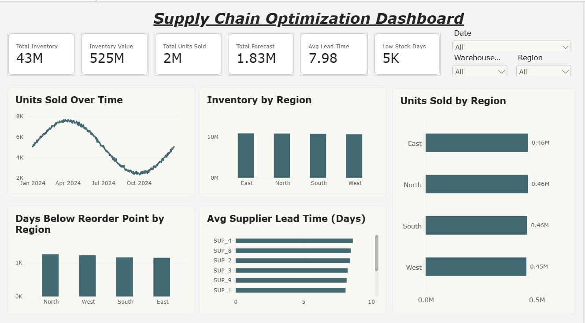

# Supply Chain Optimization Dashboard

An end-to-end analytics project that cleans supply chain data, analyzes it with SQL and Python, and presents it in an interactive Power BI dashboard.

## Problem
Businesses lose money from stockouts and excess inventory. This project tracks inventory, demand, forecast accuracy and supplier lead times in one view.

## Tools Used
Excel, SQL, Python (pandas), Power BI (DAX)

## Dataset
Synthetic supply chain data (about 6.4 MB) covering SKUs, regions, warehouses, suppliers, inventory levels and units sold.

## Key Insights
1. Demand is balanced across regions (about 0.46M units each).
2. Demand is seasonal, peaking in early 2024 and dipping around October.
3. Actual demand (about 2M units) is above forecast (1.83M).
4. About 5K inventory records are below the reorder point.
5. Average supplier lead time is about 8 days.

## Project Structure
- data/ : raw and cleaned datasets
- excel/ : Excel analysis
- sql/ : SQL queries
- python/ : data cleaning and analysis script
- powerbi/ : Power BI file (.pbix)
- dashboard/ : dashboard screenshot
- docs/ : insights and notes

## How to Use
Open powerbi/supply_chain_dashboard.pbix in Power BI Desktop.